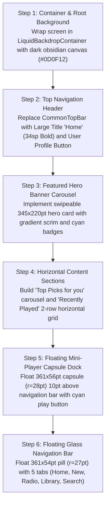

# Mobile Home Screen: Current vs. Target Design & Migration Plan

> **File Reference**: `designScreen/mobile/Home.png`  
> **Target Viewport**: Mobile Portrait (393pt × 852pt)  
> **Target Style**: Obsidian Dark Canvas (`#0D0F12`), Liquid Glass Overlays (`kyant.gitbook.io/backdrop`), Zero Red.

---

## 1. Current App Screen vs. Screenshot Comparison

| Area / Feature | Current Implementation (`app/ui/MusicListScreen.kt`, `MediaLibraryContent.kt`) | Screenshot Target (`designScreen/mobile/Home.png`) | Variance & Gap Analysis |
| :--- | :--- | :--- | :--- |
| **Canvas & Theme** | Flat solid surface (`#090C12`), automotive high-contrast dark theme without backdrop shaders. | Dynamic liquid mesh background with animated organic vector blobs behind frosted acrylic panes. | **Major Gap**: Requires liquid backdrop container with subtle morphing ambient mesh. |
| **Top Navigation** | Standard `CommonTopBar` with search input and automotive filter chip buttons. | Large `Home` title (`34sp Bold`, White) with circular profile avatar pill (`36×36pt`, `JS`). Search is its own tab. | **Major Gap**: Replace search bar at top of Home with Large Title header and user avatar. Move search into bottom navigation tab. |
| **Hero Card** | No featured hero banner; library starts directly with category tabs. | Large `Mood for You: Relax` hero card (`345×220pt`, `r=18pt`) with bottom-to-top gradient scrim, cyan eyebrow badge (`FEATURED PLAYLIST`), and featured artist blurb. | **Major Gap**: Add swipeable hero banner carousel at the top of Home. |
| **Sections & Feeds** | Vertical song list / table with alphabet fast-scroller. | Modular horizontal carousels:  1. **"Top Picks for you"** (`150×210pt` cards, `r=10pt`) 2. **"Recently Played"** (2-row horizontal grid of `150×150pt` cards) 3. **"Hits in Spatial Audio"** | **Major Gap**: Switch from flat vertical list to horizontal snapping carousels and multi-row album grids. |
| **Mini-Player Dock** | Full-width bottom bar (`AndroidAutoBottomBar`) docked to screen bottom edge with micro-scrubber. | **Floating Pill Capsule Dock** (`361×56pt`, `r=28pt`) floating `10pt` above navigation bar, with `40×40pt` artwork (`r=6pt`), title, artist, cyan play button, and next track. | **Major Gap**: Detach bar from edge; convert to elevated floating capsule with liquid glass backdrop blur. |
| **Bottom Navigation Bar** | Standard Material 3 `NavigationBar` (80dp height) docked to bottom edge. | **Floating Glass Capsule Navigation Bar** (`361×54pt`, `r=27pt`) floating `16pt` above home indicator with 5 tabs: `Home`, `New`, `Radio`, `Library`, `Search`. | **Major Gap**: Implement floating glass capsule bottom navigation with 5 Apple Music tabs. |

---

## 2. Step-by-Step Migration Plan to Match Screenshot

### Detailed Implementation Steps:
1. **Container & Background**:
   - Wrap the screen in `DesktopLiquidContainer` / `MobileLiquidContainer`.
   - Apply base obsidian color `Color(0xFF0D0F12)` with animated ambient cyan/indigo gradients.
2. **Top Navigation Header**:
   - Remove search input from the top of the Home screen.
   - Render `Row(modifier = Modifier.fillMaxWidth().padding(horizontal = 16.dp, vertical = 8.dp))` with `Text("Home", style = TextStyle(fontSize = 34.sp, fontWeight = FontWeight.Bold, color = Color.White))` and circular profile button.
3. **Hero Featured Banner**:
   - Create composable `FeaturedHeroBanner(item, onClick)`.
   - Card dimensions: `width = 345.dp`, `height = 220.dp`, shape `RoundedCornerShape(18.dp)`.
   - Include cyan badge `Text("FEATURED PLAYLIST", color = Color(0xFF00E5FF), fontSize = 11.sp, fontWeight = FontWeight.Bold)`.
4. **Content Sections**:
   - Build reusable `SectionHeader(title = "Top Picks for you", onSeeAll = { ... })`.
   - Build `LazyRow` carousels for albums and playlists with `150.dp × 150.dp` thumbnails (`r=10.dp`).
5. **Floating Mini-Player Capsule**:
   - Anchor `MobileGlassMiniPlayer` `10.dp` above the bottom bar.
   - Geometry: `height = 56.dp`, shape `RoundedCornerShape(28.dp)`, liquid glass backdrop blur `30.dp`.
   - Add Ice-Cyan play/pause button (`32.dp` circle) and next track button.
6. **Floating Bottom Navigation Bar**:
   - Implement `MobileGlassBottomNavBar` with 5 items: `Home`, `New`, `Radio`, `Library`, `Search`.
   - Active tab tinted Ice-Cyan `#00E5FF`, inactive tabs Slate `#94A3B8`.
