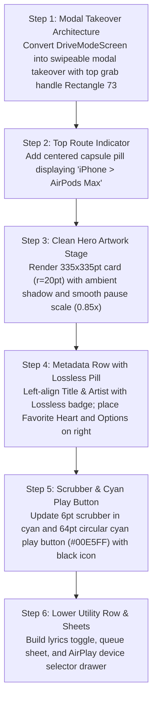

# Mobile Now Playing: Current vs. Target Design & Migration Plan

> **File Reference**: `designScreen/mobile/Now Playing.png`  
> **Target Viewport**: Mobile Portrait (393pt × 852pt)  
> **Target Style**: Obsidian Dark Canvas (`#0D0F12`), Fluid Mesh Canvas, Zero Red.

---

## 1. Current App Screen vs. Screenshot Comparison

| Area / Feature | Current Implementation (`app/ui/DriveModeScreen.kt`, `MobileHeroStage.kt`) | Screenshot Target (`designScreen/mobile/Now Playing.png`) | Variance & Gap Analysis |
| :--- | :--- | :--- | :--- |
| **Presentation Mode** | Full-screen activity or view with automotive HUD action bar at top. | **Modal Sheet Takeover** with grab handle `Rectangle 73` (`44×5pt`, `r=2.5pt`) at top center. Pulling down minimizes to mini-player. | **Major Gap**: Transition from fixed HUD screen to swipeable modal sheet takeover with dismiss handle. |
| **Top Audio Route Pill** | Automotive action buttons (Back, Video, Favorite, Download, Radio, Settings) filling top row. | Centered pill button: `iPhone > AirPods Max` (`32pt` height, `r=16pt`) showing active route and opening AirPlay sheet. | **Major Gap**: Replace automotive action row with centered audio route pill. |
| **Hero Artwork** | Responsive artwork with vinyl groove disc and floating corner buttons (favorite bottom-left, download bottom-right). | **Clean `335×335pt` Artwork Card** (`r=20pt`) with ambient colored drop shadow and scale animation (`0.85x` paused, `1.0x` playing). Corner buttons removed. | **Major Gap**: Remove floating corner overlays from artwork; move favorite and options into a dedicated row below artwork. |
| **Metadata & Quality** | Song title and `$artist • $album` subtitle in simple column. | **Track Row with Lossless Badge**: Left: Title (`22sp Bold`) + Artist (`16sp Medium`) + format badge (`LOSSLESS • ALAC 24-bit/48kHz`). Right: Favorite heart + `•••` options pill. | **Major Gap**: Add audio quality pill (`LOSSLESS`) and right-aligned favorite/options buttons. |
| **Scrubber** | Standard slider with automotive touch target. | Sleek `6pt` scrubber line (`r=3pt`) with Ice-Cyan `#00E5FF` played track, white circular knob, and `-6:10` remaining time format. | **Gap**: Update scrubber geometry, colors, and countdown timestamp formatting. |
| **Transport Controls** | Horizontal row: Shuffle, Prev (52dp), Play/Pause (64dp), Next (52dp), Repeat. | Transport row: Shuffle, Prev (`28pt`), **Elevated `64pt` Cyan Play Button** (`#00E5FF` circle with black icon), Next (`28pt`), Repeat. | **Gap**: Play button must use solid Ice-Cyan fill with black icon and ambient glow. |
| **Bottom Utility Strip** | Time display or automotive stats. | **Floating 3-Action Strip**: Lyrics icon `💬` (Left), Connected Device Pill (Center), Up Next Queue icon `☰` (Right). | **Major Gap**: Add bottom utility strip to trigger lyrics sheet, route selector, and queue drawer. |
| **Drawers & Sheets** | Right-side drawer for queue (`QueueDrawer.kt`). | 1. **AirPlay Device Selector Sheet** (AirPods Max, iPhone Speaker, MacBook Pro) 2. **Playing Next Queue Sheet** with drag reordering 3. **Song Credits Sheet** (Performing Artists, Instruments, Composition). | **Major Gap**: Build dedicated modal sheets for AirPlay output selection, credits, and draggable queue. |

---

## 2. Step-by-Step Migration Plan to Match Screenshot

### Detailed Implementation Steps:
1. **Modal Sheet Container**:
   - Wrap in `Box(modifier = Modifier.fillMaxSize().background(Color(0xFF0D0F12)))`.
   - Add top dismiss handle `Box(modifier = Modifier.width(44.dp).height(5.dp).clip(RoundedCornerShape(2.5.dp)).background(Color.White.copy(alpha = 0.35f)))`.
2. **Audio Route Pill**:
   - Implement `AudioRoutePill(activeDevice = "AirPods Max", onClick = { showRouteSheet = true })`.
3. **Hero Artwork**:
   - Remove floating download/favorite buttons from the artwork corners.
   - Animate scale: `val scale by animateFloatAsState(if (isPlaying) 1f else 0.86f)`.
4. **Metadata & Quality Badge**:
   - Layout title (`22.sp Bold`, White) and artist (`16.sp Medium`, Slate `#94A3B8`).
   - Add badge `Text("LOSSLESS • ALAC 24-bit/48kHz", color = Color(0xFF00E5FF), fontSize = 10.sp, fontWeight = FontWeight.Bold)`.
   - Right: Favorite heart icon and options `•••`.
5. **Transport Cluster**:
   - Set Play/Pause circle size to `64.dp`, background `Color(0xFF00E5FF)`, icon color `Color(0xFF0D0F12)`.
6. **Sheets & Drawers**:
   - Build `AirPlayRouteSheet` listing audio endpoints with battery percentages.
   - Build `PlayingNextSheet` with draggable queue rows and clear queue trigger.
