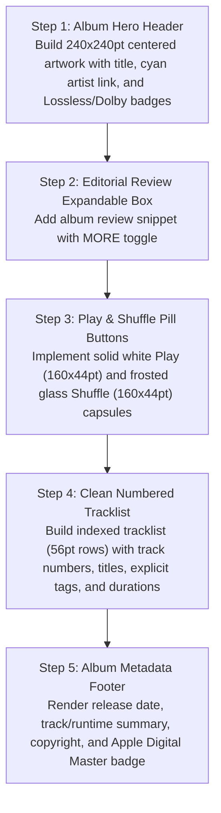

# Mobile Album View: Current vs. Target Design & Migration Plan

> **File Reference**: `designScreen/mobile/Album.png`  
> **Target Viewport**: Mobile Portrait (393pt × 852pt)  
> **Target Style**: Obsidian Dark Canvas (`#0D0F12`), Liquid Glass Action Pills, Zero Red.

---

## 1. Current App Screen vs. Screenshot Comparison

| Area / Feature | Current Implementation (`app/ui/MusicListScreen.kt` - Album mode) | Screenshot Target (`designScreen/mobile/Album.png`) | Variance & Gap Analysis |
| :--- | :--- | :--- | :--- |
| **Header Presentation** | Compact horizontal bar with basic album name and artist string. | **Collapsible Parallax Hero Header**: Centered `240×240pt` artwork (`r=14pt`), `24sp Bold` title, artist link in Cyan (`#00E5FF`), and `Pop • 2019 • Dolby Atmos • Lossless` format badge row. | **Major Gap**: Replace basic header with rich hero artwork presentation and format badges. |
| **Editorial Review** | Not present in current codebase. | Expandable album blurb: `"Let's start with that speech..."` with `MORE` inline button to expand full editorial description. | **Major Gap**: Add editorial review expandable card below header. |
| **Action Buttons** | Floating action buttons or generic menu items. | **Primary Action Row**: Solid White `▶ Play` capsule (`160×44pt`, `r=22pt`) and Frosted Glass `🔀 Shuffle` capsule (`160×44pt`, `r=22pt`), followed by secondary circular icon pills (`Download`, `Favorite`, `Share`). | **Major Gap**: Add dual Play / Shuffle pill buttons and secondary icon actions. |
| **Tracklist Rows** | Generic song item row (`SongCard.kt`, `68dp` height with embedded thumbnail). | **Numbered Track Rows (`56pt` height, NO thumbnails)**: Column 1: Index number (`1`, `2`, `3` in `14sp SemiBold`). Column 2: Track title + explicit `[E]` badge + featured artist. Column 3: Duration (`3:42`). Column 4: `•••` options. | **Major Gap**: Switch album tracks to clean numbered index rows without redundant thumbnails. |
| **Album Footer** | Not present. | Release date (`August 23, 2019`), track & duration count (`18 tracks, 1 hour 1 minute`), copyright notice, and `Apple Digital Master` badge logo. | **Gap**: Add album metadata footer at bottom of tracklist. |

---

## 2. Step-by-Step Migration Plan to Match Screenshot

### Detailed Implementation Steps:
1. **Hero Header & Artwork**:
   - Create `AlbumHeroHeader(album, artist, year, genre, artwork)`:
   - Box size `240.dp × 240.dp`, corner radius `RoundedCornerShape(14.dp)`.
   - Title: `Text(album.title, fontSize = 24.sp, fontWeight = FontWeight.Bold, color = Color.White)`.
   - Artist: `Text(album.artist, fontSize = 16.sp, fontWeight = FontWeight.SemiBold, color = Color(0xFF00E5FF))`.
   - Badges Row: `Row { Text("Pop • 2019 • Dolby Atmos • Lossless", color = Color(0xFF94A3B8), fontSize = 11.sp) }`.
2. **Editorial Review**:
   - Create `AlbumEditorialReview(text = album.reviewText)` with `maxLines = 3` and clickable `MORE` cyan text.
3. **Action Button Row**:
   - `Row(modifier = Modifier.fillMaxWidth().padding(horizontal = 16.dp), horizontalArrangement = Arrangement.spacedBy(12.dp))`:
     - Play Button: `Button(colors = ButtonDefaults.buttonColors(containerColor = Color.White), shape = RoundedCornerShape(22.dp))` with black text and play icon.
     - Shuffle Button: Glass button with white text and shuffle icon.
4. **Numbered Tracklist**:
   - Create `AlbumTrackRow(index: Int, song: Song, onPlay: () -> Unit)`:
     - Index text width `28.dp`, color `Color(0xFF64748B)`.
     - Title stacked over featured artist.
     - Duration and options `•••`.
5. **Album Footer**:
   - Append release summary at bottom of `LazyColumn`.
