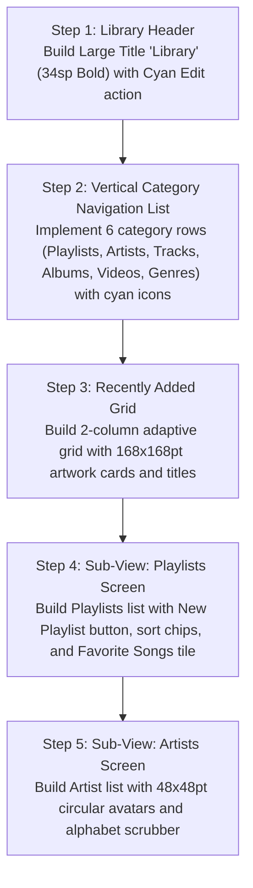

# Mobile Library Screen: Current vs. Target Design & Migration Plan

> **File Reference**: `designScreen/mobile/Library.png`  
> **Target Viewport**: Mobile Portrait (393pt × 852pt)  
> **Target Style**: Obsidian Dark Canvas (`#0D0F12`), Liquid Glass List Rows, Zero Red.

---

## 1. Current App Screen vs. Screenshot Comparison

| Area / Feature | Current Implementation (`app/ui/MusicListScreen.kt`, `MediaLibraryContent.kt`) | Screenshot Target (`designScreen/mobile/Library.png`) | Variance & Gap Analysis |
| :--- | :--- | :--- | :--- |
| **Top Navigation** | Automotive search bar + category tabs (Songs, Albums, Artists, Playlists, Folders, Radio, Downloads). | **Large Title `Library` (`34sp Bold`)** with right-aligned `Edit` button (`16sp Medium`, Cyan `#00E5FF`). | **Major Gap**: Replace horizontal tab strip with large title header and `Edit` action. |
| **Category Navigation** | Horizontal tab row at top of library screen. | **Vertical Category Navigation List**:  1. `Playlists` (`📑`) 2. `Artists` (`👤`) 3. `Tracks` (`🎵`) 4. `Albums` (`💿`) 5. `Music Videos` (`📹`) 6. `Genres` (`🎹`) Each row is `50pt` high with cyan icon, white text, and right chevron `›`. | **Major Gap**: Shift category access into a clean vertical list of rows with chevrons. |
| **Recently Added Section** | Integrated flat song list. | **2-Column "Recently Added" Grid**: Dedicated grid below category list with `168×168pt` album thumbnails (`r=10pt`), album title (`14sp SemiBold`), and artist name (`12sp Regular`). | **Major Gap**: Build dedicated 2-column "Recently Added" album grid. |
| **Playlists Sub-View** | Basic playlist card list. | **Curated Playlists View**: Top `New Playlist` button, sort bar (`Title`, `Inclusion date`, `Artist`, `Year`), `Favorite Songs` special gradient tile, and numbered playlist entries. | **Major Gap**: Add sorting filter bar and `New Playlist` creation trigger. |
| **Artists Sub-View** | Basic text rows. | **Alphabetical Artist List**: `48×48pt` circular avatars (`r=24pt`), artist name, and right chevron `›`. | **Major Gap**: Add circular artist avatars and alphabetical section headers. |

---

## 2. Step-by-Step Migration Plan to Match Screenshot

### Detailed Implementation Steps:
1. **Library Header**:
   - `Row(modifier = Modifier.fillMaxWidth().padding(horizontal = 16.dp, vertical = 12.dp))` with `Text("Library", fontSize = 34.sp, fontWeight = FontWeight.Bold)` and `Text("Edit", color = Color(0xFF00E5FF), fontSize = 16.sp)`.
2. **Category Rows**:
   - Create `LibraryCategoryRow(icon: ImageVector, title: String, onClick: () -> Unit)`:
   - Row height `50.dp`, icon tint `Color(0xFF00E5FF)`, text `17.sp`, trailing chevron `›`.
3. **Recently Added Grid**:
   - `LazyVerticalGrid(columns = GridCells.Fixed(2), horizontalArrangement = Arrangement.spacedBy(14.dp), verticalArrangement = Arrangement.spacedBy(16.dp))` below category rows.
   - Cards display `168.dp × 168.dp` artwork with `r=10.dp`.
4. **Playlists Sub-View**:
   - Implement `PlaylistBrowseView`:
   - Top action: `Button` for "New Playlist".
   - Sort dropdown: Title, Inclusion date, Artist, Year.
   - Special pinned row for `Favorite Songs`.
5. **Artists Sub-View**:
   - Implement `ArtistBrowseView`:
   - Circular avatar `48.dp × 48.dp` (`CircleShape`), title, and right chevron.
