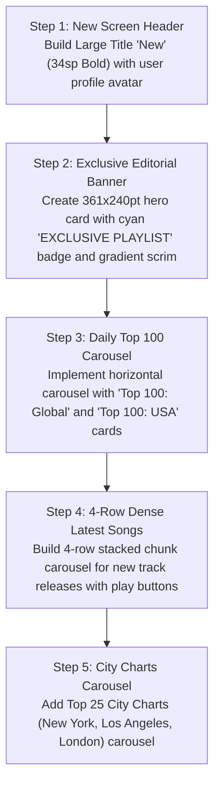

# Mobile New & Charts Screen: Current vs. Target Design & Migration Plan

> **File Reference**: `designScreen/mobile/New.png`  
> **Target Viewport**: Mobile Portrait (393pt × 852pt)  
> **Target Style**: Obsidian Dark Canvas (`#0D0F12`), Dynamic Editorial Banners, Zero Red.

---

## 1. Current App Screen vs. Screenshot Comparison

| Area / Feature | Current Implementation (`app/ui/components/RadioExploreContent.kt` / Online tabs) | Screenshot Target (`designScreen/mobile/New.png`) | Variance & Gap Analysis |
| :--- | :--- | :--- | :--- |
| **Top Navigation** | Automotive online radio / search bar. | **Large Title `New` (`34sp Bold`, White)** with circular user profile avatar. | **Major Gap**: Needs dedicated `New` exploration screen with fluid header structure. |
| **Featured Editorial Banner** | Simple text banners or generic playlist cards. | **Exclusive Editorial Banner Card (`361×240pt`, `r=18pt`)**: "EXCLUSIVE PLAYLIST", "Best Songs of 2025", full editorial description blurb, and "Curated Pop" badge. | **Major Gap**: Implement featured editorial hero banner with dynamic gradient scrim. |
| **Daily Top 100 Charts** | Not present. | **"Daily Top 100" Carousel**: `155×215pt` cards with large typography graphics (`Top 100: Global`, `Top 100: USA`). | **Major Gap**: Build Daily Top 100 horizontal chart carousel. |
| **Latest Songs Feed** | Single-column track list. | **Dense 4-Row Column Block (`Latest Songs`)**: 4 vertically stacked track items (`56pt` height each, total `224pt`) scrolling horizontally in chunks. | **Major Gap**: Implement 4-row vertical chunk horizontal carousel for new song drops. |
| **City Charts** | Not present. | **"City Charts" Carousel**: `150×210pt` cards featuring `Top 25: New York City`, `Top 25: Los Angeles`. | **Major Gap**: Add City Charts carousel. |

---

## 2. Step-by-Step Migration Plan to Match Screenshot

### Detailed Implementation Steps:
1. **New Screen Header**:
   - `Row(modifier = Modifier.fillMaxWidth().padding(horizontal = 16.dp, vertical = 8.dp))` with `Text("New", fontSize = 34.sp, fontWeight = FontWeight.Bold)` and account avatar.
2. **Editorial Hero Banner**:
   - Create `EditorialHeroBanner(item)`:
   - Dimensions: `width = 361.dp, height = 240.dp, shape = RoundedCornerShape(18.dp)`.
   - Cyan Eyebrow Badge: `Text("EXCLUSIVE PLAYLIST", color = Color(0xFF00E5FF), fontSize = 11.sp, fontWeight = FontWeight.Bold)`.
   - Headline: `Text("Best Songs of 2025", fontSize = 28.sp, fontWeight = FontWeight.Bold, color = Color.White)`.
   - Blurb: `Text("The songs that brought us from reflection to release in 2025.", color = Color(0xFF94A3B8), fontSize = 13.5.sp)`.
3. **Daily Top 100 Charts**:
   - Implement `DailyTop100Section`:
   - `LazyRow` with `155.dp × 155.dp` artwork cards, title `Top 100: Global`, subtitle `Curated Music`.
4. **Latest Songs Chunk Grid**:
   - Create `LatestSongsCarousel`:
   - Group new songs into chunks of 4 items.
   - Each column displays 4 track rows (`height = 56.dp`).
5. **City Charts Section**:
   - Implement `CityChartsSection`:
   - Horizontal carousel displaying Top 25 city playlist cards.
