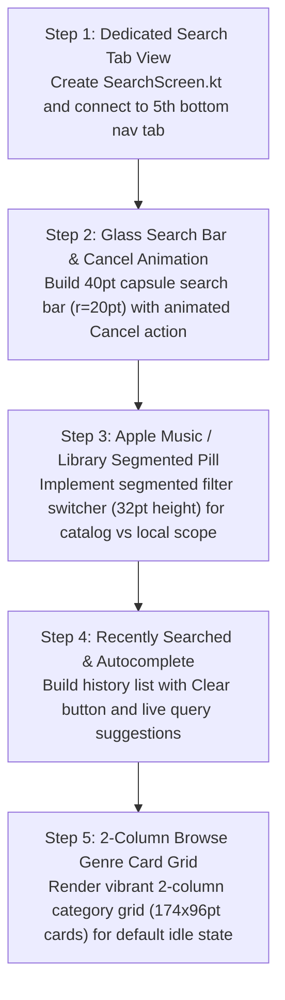

# Mobile Search & Browse: Current vs. Target Design & Migration Plan

> **File Reference**: `designScreen/mobile/Search.png`  
> **Target Viewport**: Mobile Portrait (393pt × 852pt)  
> **Target Style**: Obsidian Dark Canvas (`#0D0F12`), Glass Search Bar, Zero Red.

---

## 1. Current App Screen vs. Screenshot Comparison

| Area / Feature | Current Implementation (`app/ui/components/UnifiedGlobalSearchResults.kt`) | Screenshot Target (`designScreen/mobile/Search.png`) | Variance & Gap Analysis |
| :--- | :--- | :--- | :--- |
| **Search Access** | Text input permanently embedded inside top bar on Media Library screen. | **Dedicated Bottom Tab (`Search`)**: Large title `Search` (`34sp Bold`) collapsing into a persistent liquid glass search field with animated `Cancel` button. | **Major Gap**: Elevate Search to its own dedicated bottom navigation tab. |
| **Search Field & Glass** | Standard Material `OutlinedTextField` with angular borders. | **Liquid Glass Capsule Search Field** (`Height: 40pt`, `r=20pt`, `rgba(255,255,255,0.08)`, border `1dp rgba(255,255,255,0.10)`) with clear `✕` and interactive cancel button. | **Major Gap**: Replace basic text field with liquid glass capsule search bar. |
| **Catalog Scope Filter** | Dropdown menu or radio filters. | **Segmented Scope Pill (`32pt` height, `r=16pt`)**: Segment 1: `Apple Music` (Online). Segment 2: `Library` (Local). Active pill highlighted in Cyan (`rgba(0,229,255,0.20)`). | **Major Gap**: Implement segmented scope pill directly beneath search field. |
| **Search History** | Basic list of previous queries. | **"Recently Searched" Token List**: Header with `Clear` action (`13sp`, Cyan `#00E5FF`), query rows with history icons, search terms, and right `✕` delete buttons. | **Gap**: Add clear action and dismiss icons to search history. |
| **Autocomplete Results** | Flat list of song rows. | **Categorized Autocomplete & Instant Results**: Real-time query completions (`col...`), Top Result Hero card, followed by Songs, Artists, Albums, and Playlists. | **Gap**: Add autocomplete search query suggestions and top-result cards. |
| **Browse / Genre Grid** | Basic horizontal shelf. | **2-Column Colored Category Grid**: `174×96pt` cards with vibrant gradient backgrounds (Deep Blue, Purple, Amber, Emerald, Obsidian) and bottom-left bold titles (`Spatial Audio`, `Hip-Hop`, `Country`, `Pop`, `Set Lists`, `Charts`). | **Major Gap**: Build vibrant 2-column browse categories grid when search is idle. |

---

## 2. Step-by-Step Migration Plan to Match Screenshot

### Detailed Implementation Steps:
1. **Dedicated Search Screen Architecture**:
   - Create `MobileSearchScreen()` invoked when the 5th tab is selected.
   - Manage focus state: `var isSearchActive by remember { mutableStateOf(false) }`.
2. **Liquid Glass Search Bar**:
   - Container: `height = 40.dp`, shape `RoundedCornerShape(20.dp)`, background `Color.White.copy(alpha = 0.08f)`.
   - Magnifying glass icon `🔍`, text input, trailing clear `✕`.
   - Animated `Cancel` button: `AnimatedVisibility(visible = isSearchActive) { Text("Cancel", color = Color(0xFF00E5FF)) }`.
3. **Segmented Scope Filter**:
   - `Row` with 2 pills: `Apple Music` and `Library`.
   - Active selection colored `Color(0xFF00E5FF).copy(alpha = 0.20f)`.
4. **Recently Searched & Autocomplete**:
   - When query is blank and focused: Show `Recently Searched` with `Clear` button.
   - When query has text: Show live suggestions prefixed with `🔍`.
5. **Browse Categories Grid**:
   - When idle (unfocused):
   - Hero banner: "NOW IN SPATIAL AUDIO".
   - `LazyVerticalGrid(columns = GridCells.Fixed(2), horizontalArrangement = Arrangement.spacedBy(12.dp))` with `174.dp × 96.dp` colored genre tiles (`r=12.dp`).
