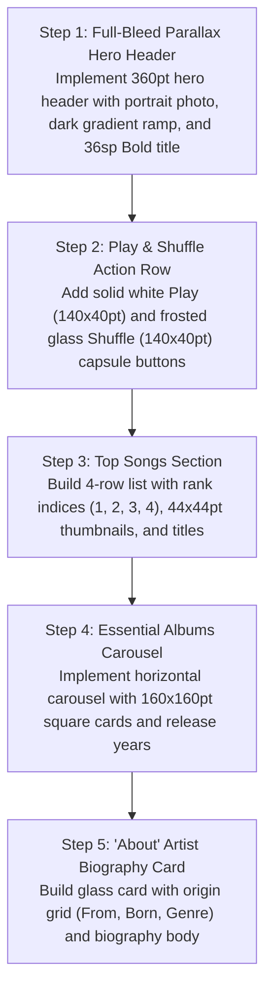

# Mobile Artist Page: Current vs. Target Design & Migration Plan

> **File Reference**: `designScreen/mobile/Artist.png`  
> **Target Viewport**: Mobile Portrait (393pt × 852pt)  
> **Target Style**: Obsidian Dark Canvas (`#0D0F12`), Full-Bleed Parallax Header, Zero Red.

---

## 1. Current App Screen vs. Screenshot Comparison

| Area / Feature | Current Implementation (`app/ui/MusicListScreen.kt` - Artist mode) | Screenshot Target (`designScreen/mobile/Artist.png`) | Variance & Gap Analysis |
| :--- | :--- | :--- | :--- |
| **Hero Presentation** | Simple top bar with artist name text. | **Full-Bleed Parallax Portrait Header (`360pt` height)**: High-resolution artist portrait photograph with bottom gradient ramp, `36sp Bold` artist name, back chevron, and `Share Artist` / `Favorite Star ★` circular glass buttons. | **Major Gap**: Replace basic text header with rich full-bleed parallax photograph header. |
| **Top Action Buttons** | Generic menu actions. | **Dual Action Capsule Row**: Solid White `▶ Play` capsule (`140×40pt`, `r=20pt`) and Frosted Glass `🔀 Shuffle` capsule (`140×40pt`, `r=20pt`), plus circular Favorite pill. | **Major Gap**: Add Play and Shuffle capsule buttons. |
| **Top Songs Section** | Generic song rows. | **4-Row "Top Songs" Section**: Column 1: Index number (`1`, `2`, `3`, `4`). Column 2: Album thumbnail (`44×44pt`, `r=6pt`). Column 3: Song title + release year. Column 4: Context options `•••`. | **Major Gap**: Format top songs with popularity rank numbers and album thumbnails. |
| **Essential Albums** | Standard album list. | **"Essential Albums" Carousel**: Horizontal snapping carousel of `160×160pt` square cards (`r=12pt`) displaying cover art, title (`14sp SemiBold`), and release year (`12sp Regular`). | **Major Gap**: Build Essential Albums horizontal snapping carousel. |
| **About Biography** | Not present in current codebase. | **"About" Artist Profile Card**: Origin details (`From: West Reading, PA`, `Born: December 13, 1989`, `Genre: Pop`) + editorial biography paragraph with `MORE` trigger. | **Major Gap**: Add rich artist biography and metadata card. |

---

## 2. Step-by-Step Migration Plan to Match Screenshot

### Detailed Implementation Steps:
1. **Parallax Hero Header**:
   - Create `ArtistHeroHeader(artist, photoUrl, onBack, onFavorite, onShare)`:
   - Box height `360.dp`, full width.
   - Parallax image: Image with vertical scroll offset multiplier `0.5f`.
   - Gradient overlay: `Brush.verticalGradient(listOf(Color.Transparent, Color(0xFF0D0F12)))`.
   - Title: `Text(artist.name, fontSize = 36.sp, fontWeight = FontWeight.Bold, color = Color.White)`.
2. **Action Capsule Row**:
   - `Row(modifier = Modifier.fillMaxWidth().padding(horizontal = 16.dp), horizontalArrangement = Arrangement.spacedBy(10.dp))`:
     - Play Button: White capsule with black text.
     - Shuffle Button: Translucent glass capsule with white text.
     - Favorite Button: Circular glass button with Cyan `★`.
3. **Top Songs Section**:
   - Create `ArtistTopSongRow(rank: Int, song: Song, onPlay: () -> Unit)`:
     - Rank number width `24.dp`, color `Color(0xFF64748B)`.
     - Album thumbnail `44.dp × 44.dp`, `r=6.dp`.
     - Title and release info.
4. **Essential Albums Carousel**:
   - Create `EssentialAlbumsSection(albums)`:
   - `LazyRow` with `160.dp × 160.dp` album cards (`r=12.dp`).
5. **About Biography Card**:
   - Create `ArtistAboutCard(artist)`:
   - Box with `RoundedCornerShape(18.dp)`, background `Color.White.copy(alpha = 0.05f)`, border `1.dp Color.White.copy(alpha = 0.08f)`.
   - Origin details: `From`, `Born`, `Genre`.
   - Editorial paragraph with `MORE` cyan trigger.
