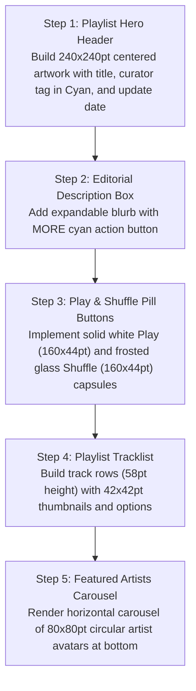

# Mobile Playlist Detail: Current vs. Target Design & Migration Plan

> **File Reference**: `designScreen/mobile/Playlist.png`  
> **Target Viewport**: Mobile Portrait (393pt × 852pt)  
> **Target Style**: Obsidian Dark Canvas (`#0D0F12`), Curated Editorial Art, Zero Red.

---

## 1. Current App Screen vs. Screenshot Comparison

| Area / Feature | Current Implementation (`app/ui/components/CommunityPlaylistCard.kt` / basic lists) | Screenshot Target (`designScreen/mobile/Playlist.png`) | Variance & Gap Analysis |
| :--- | :--- | :--- | :--- |
| **Playlist Artwork** | Basic 4-album grid thumbnail or generic folder icon. | **Rich Curated Mosaic / Editorial Artwork Card (`240×240pt`, `r=14pt`)** with drop shadow, title `Taylor Swift Essentials` / `Hits in Spatial Audio`, creator tag `Apple Music Pop` in Cyan, and last update date (`Updated 2d ago`). | **Major Gap**: Replace basic thumbnail with large centered editorial artwork header and metadata summary. |
| **Editorial Description** | Plain text or absent. | **Expandable Editorial Card**: Blurb discussing curated track highlights, Dolby Atmos spatial audio mixing, and `MORE` cyan trigger. | **Major Gap**: Add editorial description expandable section. |
| **Action Buttons** | Generic list actions. | **Dual Action Capsules**: Solid White `▶ Play` (`160×44pt`, `r=22pt`) and Frosted Glass `🔀 Shuffle` (`160×44pt`, `r=22pt`). | **Major Gap**: Add dual Play / Shuffle pill buttons. |
| **Tracklist Presentation** | Generic song row. | **Curated Playlist Rows (`58pt` height)**: `42×42pt` album thumbnails (`r=6pt`), track title (`15sp Medium`), artist name, and options button `•••`. Supports drag reordering `☰`. | **Gap**: Update row geometry and thumbnail sizes to match playlist specification. |
| **Featured Artists** | Not present in playlists. | **"Featured Artists" Circular Avatar Carousel**: Horizontal carousel of `80×80pt` circular artist avatars (`r=40pt`) with centered artist names (`13sp SemiBold`). | **Major Gap**: Add Featured Artists circular avatar carousel at bottom of playlist. |

---

## 2. Step-by-Step Migration Plan to Match Screenshot

### Detailed Implementation Steps:
1. **Hero Header**:
   - Create `PlaylistHeroHeader(playlist)`:
   - Box `240.dp × 240.dp`, `RoundedCornerShape(14.dp)`.
   - Title: `Text(playlist.name, fontSize = 24.sp, fontWeight = FontWeight.Bold, color = Color.White)`.
   - Curator: `Text("Apple Music Pop", color = Color(0xFF00E5FF), fontSize = 15.sp, fontWeight = FontWeight.SemiBold)`.
   - Update Date: `Text("Updated 2d ago • 72 songs, 4 hours 32 minutes", color = Color(0xFF94A3B8), fontSize = 12.sp)`.
2. **Editorial Description**:
   - Create `PlaylistEditorialBox(description = playlist.description)`.
   - Show 3 lines collapsed with `MORE` cyan toggle.
3. **Action Button Row**:
   - `Row(modifier = Modifier.fillMaxWidth().padding(horizontal = 16.dp), horizontalArrangement = Arrangement.spacedBy(12.dp))`:
     - Play Button: White capsule with black text.
     - Shuffle Button: Frosted glass capsule with white text.
4. **Tracklist**:
   - Create `PlaylistTrackRow(song: Song, onPlay: () -> Unit)`:
     - Thumbnail `42.dp × 42.dp`, `r=6.dp`.
     - Title, artist, explicit badge, and options `•••`.
5. **Featured Artists Carousel**:
   - Create `FeaturedArtistsSection(artists: List<Artist>)`:
   - `LazyRow` displaying `80.dp × 80.dp` circular avatars with centered names below.
