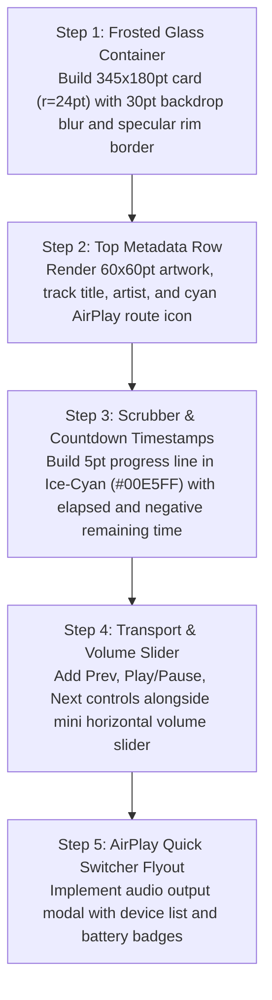

# Mobile Control Center Widget: Current vs. Target Design & Migration Plan

> **File Reference**: `designScreen/mobile/Control Center.png`  
> **Target Viewport**: Lockscreen & Notification Media Modules  
> **Target Style**: Translucent Frosted Glass `#14161A`, Dynamic Island, Zero Red.

---

## 1. Current App Screen vs. Screenshot Comparison

| Area / Feature | Current Implementation (`app/ui/car/BottomBarSeekBar.kt` / Android media notification) | Screenshot Target (`designScreen/mobile/Control Center.png`) | Variance & Gap Analysis |
| :--- | :--- | :--- | :--- |
| **Media Card Geometry** | Standard rectangular system notification layout. | **Floating Liquid Glass Media Card (`345×180pt`, `r=24pt`)**: Frosted acrylic surface `rgba(20, 22, 26, 0.82)`, specular border `1dp rgba(255, 255, 255, 0.15)`, and ambient drop shadow `elevation = 16pt`. | **Major Gap**: Requires custom glass styling for lockscreen widget and in-app quick settings panel. |
| **Top Metadata Row** | Small icon and title text. | `60×60pt` album thumbnail (`r=10pt`), track title (`16sp Bold`), artist (`13.5sp Regular`), and AirPlay connected device icon in Cyan (`#00E5FF`). | **Gap**: Increase artwork thumbnail size and add connected audio route icon. |
| **Scrubber** | Standard system seekbar. | `5pt` scrubber (`r=2.5pt`) with Ice-Cyan `#00E5FF` progress and elapsed/remaining countdown timestamps (`0:03` / `-6:10`). | **Gap**: Match scrubber height and cyan highlight. |
| **Transport Row** | Flat black-and-white buttons. | Previous (`22pt`), Play/Pause (`32pt` circle), Next (`22pt`), plus mini horizontal volume slider with speaker icons. | **Gap**: Add volume slider directly into widget transport row. |
| **AirPlay Quick Switcher** | System dialog. | **Glass Flyout Drawer (`300pt` width, `r=20pt`)**: Device entries (`AirPods Max`, `iPhone Speaker`, `MacBook Pro`) with active checkmark in Cyan and battery percentage badge (`100%`). | **Major Gap**: Build dedicated in-app audio endpoint switcher matching glass aesthetic. |

---

## 2. Step-by-Step Migration Plan to Match Screenshot

### Detailed Implementation Steps:
1. **Frosted Glass Container**:
   - Create `ControlCenterMediaWidget()`:
   - Width `fillMaxWidth() - 32.dp`, height `180.dp`, shape `RoundedCornerShape(24.dp)`.
   - Backdrop blur `30.dp`, surface `Color(0xFF14161A).copy(alpha = 0.82f)`, border `1.dp Color.White.copy(alpha = 0.15f)`.
2. **Metadata Header**:
   - `Row(modifier = Modifier.fillMaxWidth().height(60.dp))`:
     - Artwork `60.dp × 60.dp` (`RoundedCornerShape(10.dp)`).
     - Column with title and artist.
     - AirPlay icon `Icon(imageVector = Icons.Rounded.Airplay, tint = Color(0xFF00E5FF))`.
3. **Scrubber**:
   - `5.dp` progress line with `Color(0xFF00E5FF)` played track.
   - Text labels: `0:03` and `-6:10`.
4. **Transport & Volume**:
   - Prev (`⏮`), Play/Pause (`▶`/`⏸`), Next (`⏭`).
   - Horizontal slider with speaker icons.
5. **AirPlay Endpoint Drawer**:
   - Create `AudioEndpointModal()`:
   - Lists connected Bluetooth and AirPlay devices with battery badges.
