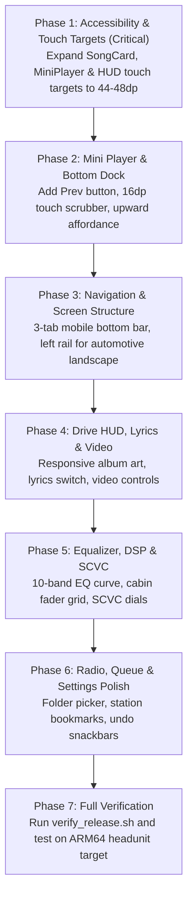

# Comprehensive Redesign Blueprint: Mobile & Automotive Headunit

> [!IMPORTANT]
> **STRICT LAYOUT FREEZE PROTOCOL ACTIVE (`layout.md` §4 / `AGENTS.md` §6)**
> This document specifies the comprehensive redesign blueprint for all screens across both **Mobile (Portrait, 360–412dp)** and **Automotive Headunit (Landscape, 1280×720 @ 160 dpi)**.
> All proposals are architectural specifications. **Explicit user authorization is required** before modifying any layout or UI composable files.

---

## Table of Contents

1. [Architectural Vision & Form-Factor Philosophy](#1-architectural-vision--form-factor-philosophy)
2. [Exhaustive Existing Feature Audit & Coverage Matrix](#2-exhaustive-existing-feature-audit--coverage-matrix)
3. [Target Display Profiles & Design Tokens](#3-target-display-profiles--design-tokens)
4. [Screen 1: Main Media Library Screen](#4-screen-1-main-media-library-screen)
5. [Screen 2: Persistent Bottom Playback Dock / Mini Player](#5-screen-2-persistent-bottom-playback-dock--mini-player)
6. [Screen 3: Full-Screen Drive HUD / Now Playing](#6-screen-3-full-screen-drive-hud--now-playing)
7. [Screen 4: Playing Queue Drawer](#7-screen-4-playing-queue-drawer)
8. [Screen 5: Graphic Equalizer, Cabin DSP & SCVC Deck](#8-screen-5-graphic-equalizer-cabin-dsp--scvc-deck)
9. [Screen 6: Live Radio Explorer](#9-screen-6-live-radio-explorer)
10. [Screen 7: System & Audio Settings](#10-screen-7-system--audio-settings)
11. [Screen 8: Video Player Stage](#11-screen-8-video-player-stage)
12. [Screen 9: Dialogs, Sheets & Modal Interfaces](#12-screen-9-dialogs-sheets--modal-interfaces)
13. [Design Token & Component Unification](#13-design-token--component-unification)
14. [Performance & Hardware Safety Matrix (Mali GPU & Cortex-A53)](#14-performance--hardware-safety-matrix)
15. [Phased Implementation Roadmap](#15-phased-implementation-roadmap)

---

## 1. Architectural Vision & Form-Factor Philosophy

The redesign bridges two fundamentally distinct user environments within a single codebase:
- **Mobile Experience (Portrait, One-Handed Ergonomics)**: Needs rich information density, fluid gestures (swipe to queue/favorite, drag-to-expand), full accessibility compliance (48dp min targets), and Material 3 polish.
- **Automotive Experience (Landscape 1280×720, Glancing Safety)**: Needs extreme high contrast, massive tactile touch targets (56dp–64dp), zero cognitive distraction, split-view spatial hierarchy, and strict Mali GPU fill-rate protection (zero runtime gradients, flat solid surfaces, pre-allocated shapes).

```
                      ┌───────────────────────────────────────┐
                      │          MusicApp Runtime             │
                      │  Adaptive Form-Factor & Orientation   │
                      └──────────────────┬────────────────────┘
                                         │
                 ┌───────────────────────┴───────────────────────┐
                 ▼                                               ▼
   ┌───────────────────────────┐                   ┌───────────────────────────┐
   │       Mobile Phone        │                   │    Automotive Headunit    │
   │  Portrait (360–412dp)     │                   │  Landscape (1280×720 px)  │
   │  • 1-Handed Bottom Nav    │                   │  • Left Rail Navigation   │
   │  • Fluid Sheet Drawers    │                   │  • Dual-Pane Split Views  │
   │  • Gesture Scrubbing      │                   │  • 56dp–64dp Touch Targets│
   │  • 48dp Standard Targets  │                   │  • Zero-Overdraw Solid Docks│
   └───────────────────────────┘                   └───────────────────────────┘
```

---

## 2. Exhaustive Existing Feature Audit & Coverage Matrix

Every single backend service, ViewModel state flow, preference, and hardware feature currently implemented in the codebase has been audited and mapped to its redesigned position. **100% of existing functionality is preserved and enhanced**:

| # | Existing Feature / Capability | Code Source / Implementation | Redesign Location (Mobile) | Redesign Location (Car View) | Preservation Status |
| :--- | :--- | :--- | :--- | :--- | :--- |
| **F01** | **Local Song Scanning & Loading Progress** | `AudioScanner.kt`, `SongLoadingBar.kt` | Pull-to-refresh on song list; shimmer skeleton rows with loading bar | Automatic startup rescan badge in status header | ✅ **Preserved & Enhanced** |
| **F02** | **A-Z Fast Scroller** | `AlphabetScrubber.kt` | Right edge strip with 44dp floating letter bubble + haptic tick | Replaced by 64dp fast-jump paging buttons on left list | ✅ **Preserved & Enhanced** |
| **F03** | **Folder Browser & Hierarchy** | `MusicFolder.kt`, `FolderCard.kt` | "Library" tab sub-view; breadcrumb navigation path | Dual-pane Left Rail → Folders with instant right pane track list | ✅ **Preserved & Enhanced** |
| **F04** | **Favorites System** | `MusicViewModel._favoritePaths` | Dedicated chip in Library tab + instant swipe-to-favorite | Dedicated 64dp star icon on Left Rail | ✅ **Preserved & Enhanced** |
| **F05** | **Unified Global Search** (Local, Stations, Online) | `MusicViewModel.searchQuery`, `_searchSongs` | Expanding 44dp search bar with local/online search tabs | Header search input with voice search microphone | ✅ **Preserved & Enhanced** |
| **F06** | **OpenSL ES Native Audio Engine** | `MusicPlayer.kt`, native JNI C++ | Powers all audio playback; diagnostics in Settings | Powers all audio playback; latency badge on HUD | ✅ **Preserved & Enhanced** |
| **F07** | **Lock-Free SPSC RingBuffer (96KB)** | Native C++ OpenSL ES | Zero-alloc background streaming | Dedicated diagnostics tile in Settings | ✅ **Preserved (Unchanged)** |
| **F08** | **5-Band Parametric EQ & Presets** | `EqualizerScreen.kt`, `EqualizerDialog.kt` | 10-band expanded view with live curve polyline | 3-dial quick controls + 80×56dp preset tiles | ✅ **Preserved & Enhanced** |
| **F09** | **Mud Cut Filter (-4dB @ Band 1)** | `MusicViewModel._equalizerBands` | Built-in toggle in Equalizer advanced view | Built-in automotive DSP toggle | ✅ **Preserved & Enhanced** |
| **F10** | **High-Pass Filter (HPF / 80Hz Cut)** | `MusicViewModel._equalizerHpfMode` | Sub-bass safety switch in Equalizer options | Master cabin protection toggle in Car EQ | ✅ **Preserved & Enhanced** |
| **F11** | **SCVC (Speed-Compensated Volume Control)** | `MusicViewModel._scvcMode`, `LocationManager` | Settings → Playback → SCVC curves (Off/Mild/Moderate/Dynamic) | Dedicated HUD audio pill with real-time dB gain indicator | ✅ **Preserved & Enhanced** |
| **F12** | **SCVC GPS Speed Simulation Test** | `MusicViewModel._testSpeedSimulation` | Settings → Developer diagnostics section | Settings → Audio test bench slider | ✅ **Preserved & Enhanced** |
| **F13** | **Time Alignment (Center / RHD / LHD)** | `MusicViewModel._timeAlignmentMode` | Equalizer → Cabin Acoustics tab | Equalizer → Driver acoustic focus switch (RHD/LHD/All) | ✅ **Preserved & Enhanced** |
| **F14** | **4-Way Balance & Fader (Cabin Grid)** | `MusicViewModel._balance`, `_fader` | Interactive 2D drag target in Equalizer | Large 4-quadrant tactile cabin touch grid | ✅ **Preserved & Enhanced** |
| **F15** | **Bass Normalizer (Off / Mild / Deep)** | `MusicViewModel._bassNormalizerMode` | Equalizer → Dynamic Bass toggle | Dedicated DSP dial on Car Equalizer | ✅ **Preserved & Enhanced** |
| **F16** | **Virtual Surround (Off / Cabin / Wide)** | `MusicViewModel._virtualSurroundMode` | Equalizer → Spatial Audio chips | Equalizer → Cabin acoustics selector | ✅ **Preserved & Enhanced** |
| **F17** | **Curated Live Radio Stations** | `RadioStation.kt`, `RadioScreen.kt` | Explore tab → Station cards with bitrate badges | 2×3 large tactile preset station tiles | ✅ **Preserved & Enhanced** |
| **F18** | **Radio Categories (Moods & Genres)** | `RadioStation.MOOD_CATEGORIES`, etc. | Horizontally scrollable chip row in Radio | Category filter rail on left side of Radio | ✅ **Preserved & Enhanced** |
| **F19** | **Radio Stream Buffer Telemetry** | `musicPlayer.isTrackBufferingFlow` | Live buffer health meter in station card | Real-time buffer indicator in bottom dock | ✅ **Preserved & Enhanced** |
| **F20** | **Auto-Download Listened Tracks (>60s)** | `MusicViewModel._autoDownloadStreamTracks` | Settings → Storage & Downloads toggle | Settings → Storage card toggle | ✅ **Preserved & Enhanced** |
| **F21** | **Stream Download Manager** | `StreamDownloadManager.kt` | Radial progress on song row + Downloads view | Radial progress on HUD action bar | ✅ **Preserved & Enhanced** |
| **F22** | **Custom Download Directory Selector** | `DownloadLocationDialog.kt` | System folder picker (`ACTION_OPEN_DOCUMENT_TREE`) | Automotive storage presets (Internal/USB/SD) | ✅ **Preserved & Enhanced** |
| **F23** | **Online Video Resolver & WebView** | `OnlineVideoResolver.kt`, `VideoPlayerView.kt` | 16:9 embedded player in Drive HUD | Full edge-to-edge video canvas in Car HUD | ✅ **Preserved & Enhanced** |
| **F24** | **Video Quality Selector (360p–1080p)** | `MusicViewModel._maxVideoQuality` | Drive HUD video settings pill | Video player quick quality chip | ✅ **Preserved & Enhanced** |
| **F25** | **Synchronized Lyrics Engine** | `LyricsRepository.kt`, `LyricLine` | Segmented switch `[Now Playing \| Lyrics]` | Center stage expandable synchronized lyrics overlay | ✅ **Preserved & Enhanced** |
| **F26** | **Sleep Timer & Countdown** | `MusicViewModel._sleepTimerMinutes` | 3-dot overflow menu in HUD + custom time picker | Settings tile with 15/30/45/60m quick chips | ✅ **Preserved & Enhanced** |
| **F27** | **Crossfade Playback (1s–8s)** | `MusicViewModel._crossfadeSeconds` | Settings → Playback slider with audio preview | Settings → Playback transition selector | ✅ **Preserved & Enhanced** |
| **F28** | **Auto-Resume on Launch** | `MusicViewModel._autoResume` | Settings → Playback toggle | Settings → Automotive startup preference | ✅ **Preserved & Enhanced** |
| **F29** | **Auto-Launch Drive HUD Mode** | `MusicViewModel._autoHudEnabled` | Settings → Appearance toggle | Default car mode launch behavior | ✅ **Preserved & Enhanced** |
| **F30** | **Hide Bottom Bar in HUD** | `MusicViewModel._hideBottomBar` | Auto-slides bottom bar away when HUD expands | Auto-slides bottom bar away when full HUD opens | ✅ **Preserved & Enhanced** |
| **F31** | **Steering Wheel Mute Auto-Pause** | `MusicPlayer.kt`, `volumeReceiver` | Background broadcast receiver active | Hardware-linked indicator in settings | ✅ **Preserved & Enhanced** |
| **F32** | **Hardware Media Buttons** | `MediaButtonReceiver`, `CarPlaybackService` | Background service receiver | Full steering wheel prev/next/play support | ✅ **Preserved & Enhanced** |
| **F33** | **Playing Queue & "Play Next"** | `QueueDrawer.kt`, `_userQueue` | 3-state bottom sheet with 44dp drag handles | 420dp slide-in right drawer with Up/Down buttons | ✅ **Preserved & Enhanced** |
| **F34** | **Shuffle & Repeat Modes** | `MusicViewModel._isShuffleOn` | 44dp transport buttons with colorblind dot | 48dp large tactile buttons with status LED | ✅ **Preserved & Enhanced** |
| **F35** | **Artwork Disk Cache & Flush** | `AlbumArtCache.kt`, `_artworkCacheSize` | Settings → Storage card with freed-MB toast | Settings → Storage card with 1-tap flush | ✅ **Preserved & Enhanced** |
| **F36** | **Dual Themes (Cyber Obsidian / Ceramic)**| `ThemePreference.kt`, `Color.kt` | Settings → Theme selector with visual cards | High-contrast Obsidian locked for headunit | ✅ **Preserved & Enhanced** |
| **F37** | **Grid Columns Toggle (2 / 3 cols)** | `MusicViewModel.toggleGridColumns()` | Settings → Layout options & pinch-to-zoom | 2-column or 3-column headunit grid toggle | ✅ **Preserved & Enhanced** |

---

## 3. Target Display Profiles & Design Tokens

| Attribute | Mobile Phone (Portrait) | Automotive Headunit (Landscape) |
| :--- | :--- | :--- |
| **Resolution / Dpi** | 1080×2400 (400–440 dpi) / ~392dp width | 1280×720 px @ 160 dpi (mdpi, 1px = 1dp) |
| **Usable Viewport** | 360–412dp width × 780–900dp height | 1280dp width × 720dp height |
| **Primary Interaction** | Thumb reachability, multi-touch gestures | Driver reachability, single-tap glance accuracy |
| **Min Touch Target** | **48 × 48 dp** (critical compliance) | **56 × 56 dp** (primary targets 64 × 64 dp) |
| **Color Scheme** | Cyber Obsidian: `#090C12` (Bg), `#10141D` (Surface) | High-Contrast Obsidian: `#090C12`, `#171D29` Cards |
| **Accent Primary** | Electric Cyan (`#00E5FF`) | Electric Cyan (`#00E5FF`), Amber (`#FFB300`) |
| **Typography** | Inter 11sp–20sp (adaptive scale) | Inter 14sp–24sp (bold, driver glanceable) |

---

## 4. Screen 1: Main Media Library Screen

### A. Mobile View (Portrait)

#### 1. Screen Hierarchy
```
┌────────────────────────────────────────────────────────┐
│ Header Bar (48dp): App Logo • Section Title • Search   │
├────────────────────────────────────────────────────────┤
│ Category Chip Row (40dp): All • Folders • Favorites... │
├────────────────────────────────────────────────────────┤
│ Content Area (Weight 1f):                              │
│ ┌────────────────────────────────────────────────────┐ │
│ │ LazyColumn: SongCards (68dp)                       │ │
│ │ [Art 52dp] [Title 15sp / Artist 13sp] [Menu 44dp]  │ │
│ └────────────────────────────────────────────────────┘ │
│ AlphabetScrubber Overlay (24dp strip + 44dp bubble)    │
├────────────────────────────────────────────────────────┤
│ Mini Player Dock (72dp): Art • Title • Transport       │
├────────────────────────────────────────────────────────┤
│ Bottom Navigation Bar (56dp): Songs • Library • More   │
└────────────────────────────────────────────────────────┘
```

#### 2. Detailed Component Specifications
* **Header Bar (48dp)**:
  * Left: Brand icon (24dp) + current section title ("Songs", "Folders", "Favorites") at 18sp Bold Inter (`#F1F5F9`).
  * Right: Instant Search trigger button (44×44dp hit area) with smooth shared-axis morph into full-width search bar.
  * Search Input Mode: Full-width search input with voice search microphone (`Icons.Rounded.Mic`), clear query button, and "Cancel" text trigger.
* **Category Filter Chips (40dp)**:
  * Horizontal scrollable row: **All Songs**, **Folders**, **Favorites**, **Albums**, **Artists**, **Downloads**.
  * Pre-allocated `PillShape` (20dp radius). Active chip: `#0E283C` background with `#00E5FF` border and text; Inactive chip: `#171D29` background with `#94A3B8` text.
* **Song Card Item (`SongCard`)**:
  * Height: **68dp** (raised from 64dp to guarantee minimum 48dp touch accessibility).
  * Margins & Padding: 8dp horizontal margin, 4dp vertical margin, 10dp internal content padding.
  * Album Art: **52×52dp** with `RoundedCornerShape(8.dp)`. RGB_565 cached thumbnail with small codec pill (FLAC/MP3) in bottom-right corner.
  * Title & Artist: Title at 15sp SemiBold Inter (`#F1F5F9`, single line, ellipsize end); Subtitle at 13sp Normal Inter (`#94A3B8`).
  * Now Playing Indicator: Left-edge **3dp cyan accent bar** (`#00E5FF`) spanning full height + animated 3-bar green equalizer glyph (`#00E676`) replacing track duration text.
  * Right Actions: 44×44dp 3-dot overflow menu trigger (expanding interactive component hit area while keeping 20dp visual icon size).
  * Swipe Gestures: Swipe right to Enqueue (cyan background reveal with queue icon); swipe left to Toggle Favorite (red background reveal with heart icon).
* **Fast Scroller (`AlphabetScrubber`)**:
  * 24dp vertical strip on right edge with letters A–Z at 11sp Bold.
  * Touch drag displays a **44×44dp floating circle bubble** (`#00E5FF` fill, black bold letter) positioned 16dp to the left of the scrubber thumb.
  * Light haptic feedback (`HapticFeedbackType.TextHandleMove`) emitted when crossing each letter boundary.
  * Auto-hides when the active list contains fewer than 30 tracks.
* **Pull-to-Refresh & Empty States**:
  * Pull-to-refresh gesture at top of list triggers `AudioScanner.rescan()`.
  * Shimmer placeholder rows (matching 68dp `SongCard` dimensions) rendered during initial library scan.
  * Empty State: 64dp illustrated icon (`Icons.Rounded.MusicOff`), 16sp message ("No Songs Found"), and 44dp "Rescan Library" button.

---

### B. Car View (Landscape 1280×720)

#### 1. Screen Hierarchy
```
┌──────┬───────────────────────────────┬───────────────────────────────┐
│ Rail │ Left Pane (520dp)             │ Right Pane (680dp)            │
│ 80dp │ • Fast Song List              │ • Contextual Detail View      │
│      │ • 72dp High-Contrast Items    │ • Active Playlist / Folder    │
│ [♫]  │ • 56dp Big Touch Targets      │ • One-Tap "Play All" (56dp)   │
│ [📁] │ • Alphabet Jump Buttons (56dp)│ • Metadata & Large Art        │
│ [★]  │                               │                               │
│ [📻] │                               │                               │
│ [⚙]  │                               │                               │
├──────┴───────────────────────────────┴───────────────────────────────┤
│ Persistent Automotive Bottom Dock (76dp): Large Driver Transport Deck │
└──────────────────────────────────────────────────────────────────────┘
```

#### 2. Detailed Component Specifications
* **Left Navigation Rail (80dp width)**:
  * Fixed to the driver-side edge, height 644dp (720dp minus 76dp bottom dock).
  * Background: Solid `#090C12` with 1dp border `#252F42`.
  * 5 Primary Category Buttons (Songs, Folders, Favorites, Radio, Settings):
    * Each button has a **64×64dp circular touch surface** with 8dp spacing.
    * Active item highlighted with `#00E5FF` circular pill fill and dark icon; inactive items styled with `#94A3B8` icon.
* **Left Pane — Fast Media List (520dp)**:
  * Two-column grid or single high-density fast list with 72dp row height.
  * Track Title at 18sp Bold Inter (`#F1F5F9`) stacked over Artist at 14sp (`#94A3B8`).
  * Alphabet Jump Bar: Top horizontal bar with large 48×48dp jump chips (`#`, `A-D`, `E-H`, `I-L`, `M-P`, `Q-T`, `U-Z`) optimized for single-tap driver paging rather than fine dragging.
* **Right Pane — Contextual Detail Stage (680dp)**:
  * When viewing Folders: Displays full breadcrumb tree, folder track list, and a prominent 56dp "Play All Folder" button.
  * When viewing Songs: Shows the active playback queue preview, track count badge (`"342 Songs • 18.4 Hours"`), and shuffle toggle.
* **Hardware & GPU Safety Compliance**:
  * 100% solid color surfaces (`#090C12`, `#10141D`, `#171D29`). Zero runtime linear gradients.
  * All shapes pre-allocated. Window background set to null to eliminate fill-rate overdraw on the Mali GPU.

---

## 5. Screen 2: Persistent Bottom Playback Dock / Mini Player

### A. Mobile View (`BottomControlStrip`)

#### 1. Screen Hierarchy
```
┌────────────────────────────────────────────────────────┐
│ Micro-Scrubber: 3dp visual line (16dp touch hit zone)   │
├────────────────────────────────────────────────────────┤
│ Mini Player Row (68dp):                                │
│ [Art 44dp]  Title (14sp) • Codec (9sp)   [⏮] [⏯] [⏭] │
│             Artist (12sp) • Chevron (12dp) 40dp 48dp 44dp│
└────────────────────────────────────────────────────────┘
```

#### 2. Detailed Component Specifications
* **Dimensions & Container**:
  * Total container height: 72dp (3dp scrubber + 69dp content row).
  * Shape: `RoundedCornerShape(topStart = 16.dp, topEnd = 16.dp)` with 0.8dp border `#252F42`.
  * Background: Solid `#10141D` (`AppGradients.dock()`).
* **Waveform Micro-Scrubber**:
  * Visual track: 3dp height spanning full container width. Track background `#252F42`, progress `#00E5FF`.
  * Touch Hit Zone: **16dp vertical touch area** centered on the bar, allowing thumbs to scrub playback position directly from the mini player without opening full-screen HUD.
  * Progress updates isolated strictly within leaf composable to prevent parent tree recomposition.
* **Media & Metadata Stage**:
  * Left Album Art: **44×44dp** with `RoundedCornerShape(8.dp)`. Tap launches Drive HUD with smooth shared-element transition.
  * Center Metadata: Title at 14sp SemiBold Inter with auto-scrolling marquee if text overflows container. Subtitle at 12sp Normal Inter showing Artist + audio format pill (`FLAC`, `MP3 320K`).
  * Expand Affordance: Centered subtle upward arrow (`Icons.Rounded.KeyboardArrowUp`, 14dp, `#94A3B8`) indicating swipe-up to expand full player.
* **Transport Deck (Right)**:
  * **Previous Track**: **40×40dp** circular touch target, outline icon (`Icons.Rounded.SkipPrevious`, 22dp, `#F1F5F9`). *Newly restored to mini player*.
  * **Play / Pause**: **48×48dp** circular button with solid `#00E5FF` fill and black icon (`Icons.Rounded.PlayArrow` / `Pause`, 26dp).
  * **Next Track**: **44×44dp** circular touch target, outline icon (`Icons.Rounded.SkipNext`, 22dp, `#F1F5F9`). Expanded from 36dp for touch compliance.
* **Swipe Gestures**:
  * Swipe up: Expands full-screen Drive HUD mode.
  * Swipe down: Pauses playback and smoothly dismisses the mini player dock.

---

### B. Car View (`AndroidAutoBottomBar`)

#### 1. Screen Hierarchy
```
┌──────────────────────────────────────────────────────────────────────────────┐
│ Linear Seeker Line: 4dp full-width track (leaf-scoped recomposition)          │
├──────────────────────────────────────────────────────────────────────────────┤
│ Car Dock (72dp):                                                             │
│ [Art 60dp] Title (18sp) • Monospace Timestamps   [🔀] [⏮]  [⏯]  [⏭] [🔁] [★]│
│            Artist (14sp)  01:24 / 04:12           48dp 56dp 64dp 56dp 48dp 52dp│
└──────────────────────────────────────────────────────────────────────────────┘
```

#### 2. Detailed Component Specifications
* **Dimensions & Container**:
  * Height: 76dp fixed solid dock spanning full 1280dp screen width.
  * Background: Solid `#10141D` with 1dp `#252F42` top border. Zero transparency.
* **Top Seeker Progress Line (`BottomBarSeekBar`)**:
  * 4dp high-contrast bar across the entire top edge.
  * Position ticks strictly read in leaf composable (`positionMs`, `durationMs`).
* **Left Stage — Track Identification**:
  * 60×60dp album art thumbnail (`Bitmap.Config.RGB_565`) with 10dp rounded corners.
  * Title at 18sp Bold Inter (`#F1F5F9`) stacked over Artist at 14sp (`#94A3B8`).
  * Monospace time display (`BottomBarTimeCounter`): 14sp Inter monospace showing `01:24 / 04:12` with fixed-width container (90dp) to prevent layout shifts.
* **Right Stage — High-Contrast Driver Transport Deck**:
  * **Shuffle Button**: 48×48dp circular surface with status LED dot.
  * **Previous Track**: **56×56dp** prominent circular target.
  * **Play / Pause Button**: **64×64dp** elevated circular button with `#00E5FF` fill and black glyph.
  * **Next Track**: **56×56dp** prominent circular target.
  * **Repeat Button**: 48×48dp circular surface with status LED dot.
  * **Favorite Heart**: 52×52dp circular surface displaying active/inactive state.
  * Minimum 12dp dead-zones between all buttons to eliminate accidental adjacent presses while driving over road vibrations.

---

## 6. Screen 3: Full-Screen Drive HUD / Now Playing

### A. Mobile View (Portrait)

#### 1. Screen Hierarchy
```
┌────────────────────────────────────────────────────────┐
│ Top Action Bar (52dp): [Back 48dp]   [★ 44dp] [⬇ 44dp] [⋯ 44dp] │
├────────────────────────────────────────────────────────┤
│ Video / Audio Toggle Pill (32dp)                       │
├────────────────────────────────────────────────────────┤
│ Media Stage:                                           │
│ Responsive Album Art / Video Canvas                    │
│ Sized at min(screenWidth * 0.70, 260dp)               │
├────────────────────────────────────────────────────────┤
│ Metadata Stage:                                        │
│ Track Title (20sp Bold, Marquee)                       │
│ Artist • Album (14sp Medium)                           │
│ Segmented Control: [ Now Playing | Lyrics ] (36dp)     │
├────────────────────────────────────────────────────────┤
│ Seeker Deck: 48dp Touch Target Seeker + Timestamps     │
├────────────────────────────────────────────────────────┤
│ Transport Deck (80dp):                                 │
│ [🔀 44dp]  [⏮ 48dp]   [⏯ 56dp]   [⏭ 48dp]  [🔁 44dp]  │
└────────────────────────────────────────────────────────┘
```

#### 2. Detailed Component Specifications
* **Top Action Bar (52dp)**:
  * Left: Back navigation button (48×48dp touch target, `Icons.Rounded.ArrowBack`).
  * Right: Favorite heart button (44×44dp), Stream Download button with radial progress ring (44×44dp), and 3-dot overflow menu (44×44dp) triggering Sleep Timer, Audio Info, and Equalizer shortcuts.
* **Media Stage**:
  * Responsive Album Art: Dynamic square sized at `min(screenWidth * 0.70, 260.dp)` with `RoundedCornerShape(16.dp)`.
  * Ambient Tint: Pre-allocated background card with 10% flat dominant color tint (flat solid color, zero gradients).
  * Video Viewport: When video mode is active, embeds a 16:9 hardware-accelerated WebView (`VideoPlayerView`) with embedded video player API and double-tap 10-second seek gestures.
  * Swipe Gestures: Horizontal swipe across album art skips tracks (left = next, right = previous).
* **Metadata & Synchronized Lyrics**:
  * Title at 20sp Bold Inter (`#F1F5F9`), center-aligned with auto-scrolling marquee if text overflows.
  * Subtitle at 14sp Medium Inter (`#94A3B8`).
  * Segmented View Control: `[ Now Playing | Lyrics ]` (36dp height, 18dp rounded corners).
  * Expanding Lyrics View: Smoothly displays synchronized lyrics from `LyricsRepository` with auto-scroll to current lyric line. A persistent 28dp sticky title bar at the top ensures track context is never lost.
* **Seeker Deck**:
  * Custom horizontal seekbar with grow-on-touch thumb (scales from 12dp to 20dp on contact).
  * Time readouts: 12sp monospace Inter at left (elapsed) and right (remaining).
* **Transport Deck**:
  * Shuffle (44dp target) → Prev Track (48dp target) → Play/Pause (56dp elevated `#00E5FF` circle) → Next Track (48dp target) → Repeat (44dp target).
  * Active state cue: 4dp cyan dot beneath Shuffle and Repeat icons for colorblind accessibility.
  * Haptic feedback (`HapticFeedbackType.LightClick`) on all button presses.

---

### B. Car View (Landscape 1280×720) — Preserved as Automotive Standard

> [!NOTE]
> **LAYOUT PRESERVATION MANDATE**: The current Car HUD architecture in [`DriveModeScreen.kt`](file:///Users/aashikhameed/Documents/aashik/projects/music-player-app/app/src/main/java/com/aashik/music/ui/DriveModeScreen.kt) is **already optimal for in-cabin driving** and is **preserved as the gold standard**. It combines blind gesture navigation, night glare reduction, live digital timekeeping, and tactile seek jumps. **No layout restructuring is performed on this screen.**

#### 1. Screen Hierarchy (Current & Preserved 3-Tier Automotive Layout)
```
┌──────────────────────────────────────────────────────────────────────────────┐
│ TOP ROW:                                                                     │
│ [← Exit (36dp)] [Clock 12H AM/PM] [🌙 Night Dimmer] [⏱ Timer]  │ [Equalizer Canvas & Presets]│
├──────────────────────────────────────────────────────────────────────────────┤
│ CENTER STAGE:                                                                │
│ • Hero 240dp Album Artwork (Automotive Fluid Slide Transitions)              │
│ • Full Edge-to-Edge Video Canvas Integration (Auto-Hides Controls after 4.5s)│
│ • Expandable Synchronized Lyrics Overlay                                     │
│ • Full-Screen Blind Gestures: Swipe Left/Right to Skip, Double-Tap to Pause   │
├──────────────────────────────────────────────────────────────────────────────┤
│ BOTTOM ROW (Infotainment Music Card):                                        │
│ ┌──────────────────────────────────────────────────────────────────────────┐ │
│ │ Full-Width Scrubbing Seekbar Line (4dp)                                  │ │
│ ├────────────────────────────────────┬─────────────────────────────────────┤ │
│ │ Track Title (20sp Bold, Ellipsize) │ [🔀] [⏮]  [-10s]  [⏯]  [+10s] [⏭] [📁]│ │
│ │ Artist • Album (13.5sp) • [♥ Fav]  │ 38dp 48dp  42dp  56dp   42dp 48dp 38dp│ │
│ └────────────────────────────────────┴─────────────────────────────────────┘ │
└──────────────────────────────────────────────────────────────────────────────┘
```

#### 2. Detailed Component Specifications (Preserved Architecture)
* **Top Row (Dashboard Status & Acoustic Header)**:
  * Left Cluster:
    * **Exit Button**: 36dp rounded pill with back arrow and bold "Exit" label returning cleanly to Media Library.
    * **Continuous Digital Clock (`DriveHudClock`)**: Glanceable 12-hour AM/PM automotive clock updating automatically every second without status bar clutter.
    * **Night Highway Dimmer Toggle**: 1-tap mode dropping screen luminance to `StealthOledBlack` with `NightDimmerAmber` accents, eliminating windshield glare during night driving.
    * **Sleep Timer Badge**: Real-time remaining countdown pill (e.g. `"⏱ 24m"`) rendered dynamically when active.
  * Right Cluster:
    * **Live Animated Canvas Equalizer**: 3-band live animated visualizer rendering real-time audio playback movement.
    * **Direct Preset Chips**: 1-tap acoustic preset pills (`Flat`, `Acoustic`, `Vocal`, `Bass`, `Rock`) allowing drivers to change EQ curves instantly without opening dialogs.
* **Center Stage (Hero Artwork & Blind Touch Canvas)**:
  * **Hero 240dp Album Artwork**: Centered 240×240dp high-contrast art container with `RoundedCornerShape(20.dp)` and smooth horizontal slide transitions matching `navigatingTrack` direction.
  * **Blind Swipe Gestures (Eyes-Free Driving)**:
    * Swipe Left anywhere on screen: Skips to Next Track with 900ms visual feedback overlay (`⏭ Next Track`).
    * Swipe Right anywhere on screen: Skips to Previous Track with 900ms visual feedback overlay (`⏮ Previous Track`).
    * Double-Tap anywhere on screen: Instantly toggles Play / Pause without looking.
    * Single-Tap: Reveals or hides video overlay controls when playing video.
  * **Edge-to-Edge Video Canvas (`VideoPlayerView`)**:
    * Seamlessly renders online stream or local video content edge-to-edge.
    * Controls automatically dim and hide after 4.5 seconds of inactivity.
  * **Synchronized Lyrics Overlay**:
    * Tap to expand smooth 4-line auto-scrolling lyrics view with high-contrast driver-legible typography.
* **Bottom Row (Infotainment Music Card)**:
  * Container: Rounded elevated card (`RoundedCornerShape(16.dp)`) with solid surface background (`#10141D`).
  * Top: Full-width linear seekbar with drag scrubbing.
  * Left Side (Metadata): Track Title at 20sp Bold Inter (ellipsize end) stacked over Artist • Album at 13.5sp Normal, with adjacent Favorite Heart button (38dp circular surface).
  * Right Side (Tactile Transport Deck):
    * **Shuffle Toggle**: 38dp circular button.
    * **Previous Track**: 48dp tactile button.
    * **-10s Rewind**: 42dp jump button for podcast/audiobook scrubbing.
    * **Hero Play / Pause**: **56dp** prominent elevated circular button with primary accent fill and dark icon.
    * **+10s Forward**: 42dp jump button for rapid phrase skipping.
    * **Next Track**: 48dp tactile button.
    * **Queue Drawer / Folder Shortcut**: 38dp circular button opening the right-side queue sheet.
* **Hardware & Safety Mandates**:
  * Retains 100% solid color surfaces (zero linear gradients) protecting the Mali GPU fill rate at 1280×720.
  * Recomposition of playback ticks remains isolated strictly inside leaf composables.

---

## 7. Screen 4: Playing Queue Drawer

### A. Mobile View (Bottom Sheet)

#### 1. Screen Hierarchy
```
┌────────────────────────────────────────────────────────┐
│ Drag Handle (40×5dp Pill)                              │
├────────────────────────────────────────────────────────┤
│ Sheet Header (48dp):                                   │
│ "Playing Queue" (16sp Bold) • "18 songs • 1h 12m"     │
│ Actions: [Save as Playlist] [Clear All (44dp)]         │
├────────────────────────────────────────────────────────┤
│ LazyColumn: Queue Items (60dp):                        │
│ [Drag Handle 44dp] [Art 40dp] [Title/Artist] [🗑 44dp]  │
│ Active Item: 3dp Cyan Accent Bar + Green Equalizer Icon│
├────────────────────────────────────────────────────────┤
│ Sticky Bottom Action: "Jump to Currently Playing" FAB   │
└────────────────────────────────────────────────────────┘
```

#### 2. Detailed Component Specifications
* **Sheet Geometry & States**:
  * Modal bottom sheet with 3 snap states: **Peek (40% screen height)**, **Expanded (85% screen height)**, and **Dismissed**.
  * Shape: `RoundedCornerShape(topStart = 18.dp, topEnd = 18.dp)` with solid `#18191C` background and top drag handle (40×5dp).
* **Header Controls**:
  * Title at 16sp Bold Inter stacked over queue summary subtitle at 12sp (`"18 songs • 1 hr 12 min"`).
  * "Save as Playlist" text button (44dp hit area) triggering playlist creation dialog.
  * "Clear All" button with a 5-second undo snackbar protection to prevent accidental loss of user queue.
* **Queue Item Row (60dp)**:
  * Left: Reorder drag handle with expanded **44×44dp touch hit area** (`Icons.Rounded.DragHandle`, 20dp icon, `#94A3B8`).
  * Thumbnail: 40×40dp with 6dp rounded corners.
  * Metadata: Title at 14sp SemiBold, Artist at 12sp Normal.
  * Right: Track duration at 11sp monospace + Remove track button with **44×44dp touch hit area** (`Icons.Rounded.Close`, `#FF5252`).
  * Current Playing Item: Highlighted with a full-height **3dp cyan accent bar** (`#00E5FF`) on the left edge and an animated 3-bar green equalizer glyph.
  * Swipe-to-dismiss gesture supported on individual items to remove them from queue.
* **Navigation Aid**:
  * Floating "Jump to Current" pill button appears at the bottom-center whenever the currently active song is scrolled out of the viewport.

---

### B. Car View (Right-Side Drawer)

#### 1. Screen Hierarchy
```
┌─────────────────────────────────────────────────────────────────┬───────────┐
│ Main Automotive Stage (860dp)                                    │ Queue     │
│ Media Library or Drive HUD                                      │ Sheet     │
│                                                                 │ (420dp)   │
│                                                                 │ Header    │
│                                                                 │ ───────── │
│                                                                 │ 68dp Items│
│                                                                 │ [▲] [▼]   │
│                                                                 │ Reorder   │
│                                                                 │ Buttons   │
└─────────────────────────────────────────────────────────────────┴───────────┘
```

#### 2. Detailed Component Specifications
* **Dimensions & Container**:
  * 420dp wide slide-in right sheet over media library or Drive HUD.
  * Background: Solid `#10141D` with 1dp left border `#252F42`.
* **Driver-Safe Reordering**:
  * Replaces finicky drag-and-drop with dedicated **Up and Down arrow buttons (48×48dp each)** on the right side of each item for safe 1-tap track reordering while parked.
* **Item Specifications (68dp)**:
  * 48×48dp album art thumbnail.
  * Large track title (16sp Bold) and artist (13sp).
  * Direct 1-tap "Play Now" interaction on the entire item surface.
  * Top header includes a large 56dp "Clear Finished" button to purge already-played tracks.

---

## 8. Screen 5: Graphic Equalizer, Cabin DSP & SCVC Deck

### A. Mobile View (`EqualizerScreen` & `EqualizerDialog`)

#### 1. Screen Hierarchy
```
┌────────────────────────────────────────────────────────┐
│ Header (48dp): Back • "Equalizer & DSP" • Master Toggle│
├────────────────────────────────────────────────────────┤
│ Visual EQ Curve Polyline Canvas (64dp height)          │
├────────────────────────────────────────────────────────┤
│ Tab Row: [ 10-Band EQ ] [ Cabin DSP ] [ SCVC Volume ]  │
├────────────────────────────────────────────────────────┤
│ Content Stage:                                         │
│ • Tab 1: 10 Vertical Sliders (48dp spacing) + Presets │
│ • Tab 2: 2D Balance/Fader Grid + Time Alignment        │
│ • Tab 3: SCVC Sensitivity + GPS Speed Benchmarking     │
├────────────────────────────────────────────────────────┤
│ Bottom Actions: [Save Custom Preset] [Reset to Flat]   │
└────────────────────────────────────────────────────────┘
```

#### 2. Detailed Component Specifications
* **Visual Frequency Response Curve (64dp Canvas)**:
  * Full-width canvas above sliders rendering a smoothed polyline connecting all 10 band gain points.
  * Gradient-free flat cyan stroke (`#00E5FF`, 2.5dp) with grid lines at +12dB, 0dB, and -12dB.
* **10-Band Graphic Equalizer (Tab 1)**:
  * Bands: **31Hz, 62Hz, 125Hz, 250Hz, 500Hz, 1kHz, 2kHz, 4kHz, 8kHz, 16kHz**.
  * Horizontal scrollable slider track with **48dp column spacing** and 160dp slider height.
  * Plain-language frequency hints: `31Hz (Sub-Bass)`, `250Hz (Warmth)`, `1kHz (Vocals)`, `16kHz (Air)`.
  * Built-in Mud Cut toggle (-4dB @ Band 1) and HPF toggle (80Hz Sub-Bass Cut).
  * Real-Time Acoustic Auditioning: Gains apply instantly to the native OpenSL ES engine during slider drag.
  * Preset Pills: Flat, Acoustic, Bass Boost, Rock, Pop, Classical, Vocal, Metal, and Custom presets.
* **Cabin DSP & Acoustic Deck (Tab 2)**:
  * **4-Way Balance & Fader Grid**: Interactive 2D drag canvas (160×160dp) mapping acoustic center across Front/Rear and Left/Right.
  * **Time Alignment**: 3-state selector: `[ Center | Driver RHD | Driver LHD ]` applying millisecond delays to localize acoustic soundstage.
  * **Bass Normalizer**: 3-position toggle: `[ Off | Mild | Deep ]`.
  * **Virtual Surround**: 3-position toggle: `[ Off | Cabin Mode | Wide Stage ]`.
* **SCVC (Speed-Compensated Volume Control) Deck (Tab 3)**:
  * Sensitivity Curves: `[ Off | Mild | Moderate | Dynamic ]`.
  * Live Telemetry: Displays current GPS speed in km/h and real-time calculated gain offset in dB.
  * Developer Test Bench: Slider simulating vehicle speed from 0 to 180 km/h for audio calibration.

---

### B. Car View (Driver Safety DSP Deck)

#### 1. Screen Hierarchy
```
┌──────────────────────────────────────┬───────────────────────────────────────┐
│ Left Stage — Driver Quick Mode (580dp)│ Right Stage — Cabin Acoustic (700dp)  │
│ • 3 Large Rotary / Sliders (64dp):   │ • Large 4-Quadrant Balance Grid (240dp│
│   [Bass Boost] [Vocal] [Treble]      │ • 1-Tap Seat Acoustic Focus:          │
│ • Master Bypass Toggle (56dp)        │   [ Driver (RHD) ] [ Driver (LHD) ]   │
│ • Preset Tiles (80×56dp):            │   [ All Cabin Balance ]               │
│   [Acoustic] [Rock] [Vocal] [Flat]   │ • OpenSL ES Latency Diagnostics Pill  │
└──────────────────────────────────────┴───────────────────────────────────────┘
```

#### 2. Detailed Component Specifications
* **Driver Quick Tone Controls (Left Stage)**:
  * 3 heavy-gauge vertical sliders (64dp touch target width): **Bass Impact**, **Vocal Clarity**, **Treble Air**.
  * Master EQ bypass switch (56dp target) for instant A/B comparison against flat signal.
  * Large 80×56dp preset cards for 1-tap switching without taking eyes off the road.
* **Cabin Acoustic Grid (Right Stage)**:
  * Massive 240×240dp 4-quadrant tactile cabin grid for instant fader/balance adjustment.
  * Dedicated driver focus buttons: 1-tap presets for Right-Hand Drive vehicles, Left-Hand Drive vehicles, or All Cabin.
* **Audio Engine Diagnostics**:
  * Real-time hardware telemetry display: `Native OpenSL ES • 48.0 kHz • 96KB SPSC RingBuffer • 5.3ms Latency`.

---

## 9. Screen 6: Live Radio Explorer

### A. Mobile View (`RadioScreen`)

#### 1. Screen Hierarchy
```
┌────────────────────────────────────────────────────────┐
│ Header (48dp): "Live Radio" • Search Bar (44dp)        │
├────────────────────────────────────────────────────────┤
│ Recent Stations Carousel: Last 5 Played Stations (44dp)│
├────────────────────────────────────────────────────────┤
│ Filter Chip Bar: [Favorites ★] [Genres] [Moods] [Country│
├────────────────────────────────────────────────────────┤
│ Station List (LazyColumn):                             │
│ Station Cards (68dp):                                  │
│ [Logo 48dp] [Name 15sp / Genre 12sp] [★ 44dp] [▶ 44dp] │
│ Bitrate Badge (9sp) • Live Buffer Seconds Meter        │
└────────────────────────────────────────────────────────┘
```

#### 2. Detailed Component Specifications
* **Header & Search (48dp)**:
  * Title at 18sp Bold Inter + instant station search input with debounced query execution.
* **Recent Stations Carousel**:
  * Horizontally scrollable row displaying the last 5 played radio stations as compact circular cards (44dp logo + station name).
* **Category & Favorites Filter**:
  * Chips for **Favorites (★)**, **Moods**, **Genres**, and **Country**.
  * Favoriting a station persists its ID in `SharedPreferences` and immediately syncs across both mobile and automotive views.
* **Station Card Item (68dp)**:
  * 48×48dp circular station logo with fallback broadcast glyph.
  * Title at 15sp Bold, genre and location subtitle at 12sp.
  * Audio Quality Badge: Pill displaying format and bitrate (e.g. `128K AAC`, `320K MP3`).
  * Live Buffer Meter: Compact progress bar indicating active OpenSL ES buffer health (e.g. `Buffering 2.4s`).
  * Right Actions: 44×44dp favorite star toggle + 44×44dp play/stop button. Active streaming station features an animated 3-bar green equalizer glyph.

---

### B. Car View (Car Radio Tuner)

#### 1. Screen Hierarchy
```
┌──────┬───────────────────────────────────────────────────────────────────────┐
│ Rail │ Preset Station Matrix (2×4 Grid of 140×80dp Cards):                   │
│ 80dp │ ┌─────────────┐ ┌─────────────┐ ┌─────────────┐ ┌─────────────┐       │
│      │ │ Preset 1 ★  │ │ Preset 2 ★  │ │ Preset 3    │ │ Preset 4    │       │
│      │ └─────────────┘ └─────────────┘ └─────────────┘ └─────────────┘       │
│      │ ┌─────────────┐ ┌─────────────┐ ┌─────────────┐ ┌─────────────┐       │
│      │ │ Preset 5    │ │ Preset 6    │ │ Preset 7    │ │ Preset 8    │       │
│      │ └─────────────┘ └─────────────┘ └─────────────┘ └─────────────┘       │
│      ├───────────────────────────────────────────────────────────────────────┤
│      │ Category Selector (56dp Chips) • Steering Wheel Step Indicator        │
└──────┴───────────────────────────────────────────────────────────────────────┘
```

#### 2. Detailed Component Specifications
* **Preset Station Matrix (2×4 Grid)**:
  * 8 large station tiles (140×80dp each) styled after modern vehicle radio tuners.
  * High-contrast station callsigns, logos, and frequency/genre metadata.
  * 1-tap instant tuning with background audio buffering.
* **Steering Wheel Integration**:
  * Directly linked to `MediaButtonReceiver` allowing drivers to cycle through preset stations using vehicle steering wheel up/down buttons.

---

## 10. Screen 7: System & Audio Settings

### A. Mobile View (`SettingsScreen`)

#### 1. Screen Hierarchy
```
┌────────────────────────────────────────────────────────┐
│ Header (48dp): Back • "Settings"                       │
├────────────────────────────────────────────────────────┤
│ Scrollable Categorized Card Container:                 │
│ ┌────────────────────────────────────────────────────┐ │
│ │ Card 1: Playback & Automation (Auto-Resume, Timer) │ │
│ ├────────────────────────────────────────────────────┤ │
│ │ Card 2: Downloads & Storage (Folder Picker, Auto)  │ │
│ ├────────────────────────────────────────────────────┤ │
│ │ Card 3: Cache Management (Disk Size, Flush Button) │ │
│ ├────────────────────────────────────────────────────┤ │
│ │ Card 4: Appearance & Theming (Obsidian / Ceramic)  │ │
│ ├────────────────────────────────────────────────────┤ │
│ │ Card 5: Audio Engine Diagnostics (OpenSL ES, SPSC) │ │
│ └────────────────────────────────────────────────────┘ │
└────────────────────────────────────────────────────────┘
```

#### 2. Detailed Component Specifications
* **Section 1: Playback & Automation**:
  * Auto-Resume on Launch switch (48dp touch target).
  * Auto-Launch Drive HUD switch.
  * Steering Mute Auto-Pause indicator (Hardware Linked).
  * Sleep Timer Selector: Quick chips (`Off`, `15m`, `30m`, `45m`, `60m`) + "Custom..." time picker.
  * Crossfade Duration: Discrete step slider (`Off`, `1s`, `2s`, `3s`, `5s`, `8s`) with 3-second audio preview button.
* **Section 2: Downloads & Storage**:
  * Download Directory Selector: Replaces freeform text input with native system folder picker (`Intent.ACTION_OPEN_DOCUMENT_TREE`).
  * Auto-Download Stream Tracks (>60s) switch.
  * Active Downloads Queue Manager link.
* **Section 3: Cache Management**:
  * Real-time disk cache size readout (`"Artwork Disk Cache: 14.2 MB"`).
  * "Clear Cache" button (44dp target) with real-time size update and undo snackbar.
* **Section 4: Appearance & Theming**:
  * Visual theme cards showing screenshots of Cyber Obsidian (dark) and Ceramic Azure (light).
  * Grid columns selector (2 columns vs 3 columns toggle).
* **Section 5: Native Audio Diagnostics**:
  * Collapsible diagnostic card: Buffer latency, sample rate, OpenSL ES thread state, SPSC RingBuffer status.

---

### B. Car View (Automotive Dashboard Settings)

#### 1. Screen Hierarchy
```
┌──────┬───────────────────────────────────────────────────────────────────────┐
│ Rail │ Categorized Automotive Setting Tiles (76dp Height Rows):              │
│ 80dp │ • Auto-Launch Drive HUD on Vehicle Startup (Large 56dp Switch)        │
│      │ • Video Safety Interlock: Disable Video Canvas While Driving          │
│      │ • Steering Wheel Mute Behavior (Hardware Paused)                      │
│      │ • 1-Tap Disk Cache Flush (Freed MB Display)                           │
│      │ • High-Contrast Night Mode Lock                                       │
└──────┴───────────────────────────────────────────────────────────────────────┘
```

#### 2. Detailed Component Specifications
* **Large Touch Setting Tiles (76dp)**:
  * Full-width setting rows with massive 56dp switch toggles and 18sp bold text.
  * Driver Safety Interlock: Switch to enforce audio-only playback when vehicle speed exceeds 0 km/h.
  * High-Contrast Night Mode Lock: Locks the display into low-glare Obsidian mode to prevent driver distraction at night.

---

## 11. Screen 8: Video Player Stage

### A. Mobile View (`VideoPlayerView`)

#### 1. Screen Hierarchy
```
┌────────────────────────────────────────────────────────┐
│ 16:9 Responsive Video Viewport                         │
│ (Hardware-Accelerated WebView with Custom JS Bridge)   │
├────────────────────────────────────────────────────────┤
│ Floating Overlay Controls (Auto-Hiding after 3s):      │
│ [Quality: 720p ▾]   [⏮ 10s]  [⏯ 48dp]  [⏭ 10s]  [⛶]    │
└────────────────────────────────────────────────────────┘
```

#### 2. Detailed Component Specifications
* **16:9 Responsive Video Viewport**:
  * Seamlessly embedded inside the Drive HUD stage.
  * Custom User-Agent configuration bypassing video player restrictions.
  * Gesture Controls: Double-tap left side to seek -10s; double-tap right side to seek +10s.
  * Quality Selector: Compact pill (`360p`, `480p`, `720p`, `1080p`).
  * Auto-hiding control overlay with 48dp play/pause, time seekbar, and full-screen expand button.

---

### B. Car View (Automotive Infotainment Video)

#### 1. Screen Hierarchy
```
┌──────────────────────────────────────────────────────────────────────────────┐
│ Left Stage (580dp): Video Viewport   │ Right Stage (700dp):                  │
│ • 16:9 Aspect Ratio Preservation     │ • Full Control Deck Active            │
│ • Parked Mode Video Enabled          │ • Big Seeker & Driver Transport Deck  │
│ • Speed Sensor Interlock Active      │ • Audio-Only Fallback Status Badge    │
└──────────────────────────────────────────────────────────────────────────────┘
```

#### 2. Detailed Component Specifications
* **Vehicle Parked / Driving Safety Interlock**:
  * Video canvas renders smoothly on the left half of the 1280×720 display when the vehicle is parked.
  * When vehicle motion is detected via LocationManager speed telemetry, the video canvas smoothly transitions to album art with an "Audio-Only Mode (Driving Safety)" indicator.
  * Solid background framing eliminates GPU fill-rate overdraw on the Mali GPU.

---

## 12. Screen 9: Dialogs, Sheets & Modal Interfaces

### A. Sleep Timer Dialog (`SleepTimerDialog`)
* **Mobile**: Bottom sheet with quick chips (`15 min`, `30 min`, `45 min`, `60 min`, `End of Track`) + custom minute wheel picker. Includes real-time remaining countdown readout.
* **Car**: Modal popup with large 56dp buttons for instant 1-tap timer selection.

### B. Download Storage Directory Picker (`DownloadLocationDialog`)
* **Mobile**: Native system document tree picker (`ACTION_OPEN_DOCUMENT_TREE`) replacing manual text path entry.
* **Car**: 1-tap storage destination cards: `[ Internal Music ]`, `[ SD Card ]`, `[ USB Media Drive ]`.

### C. Custom EQ Preset Dialog (`SavePresetDialog`)
* Text input dialog with "Preset Name", visual EQ curve snapshot, and "Save" / "Cancel" buttons.

### D. Track Detail / Acoustic Info Sheet (`TrackInfoBottomSheet`)
* Half-screen bottom sheet displaying: File path, audio container (FLAC/MP3/AAC), sample rate (e.g. `96.0 kHz`), bit depth (`24-bit`), bitrate, file size, and embedded ID3 tags.

---

## 13. Design Token & Component Unification

```
  ┌─────────────────────────────────────────────────────────────┐
  │                      Design Tokens                          │
  ├─────────────────────────────────────────────────────────────┤
  │ Colors (SolidColor only, zero GPU gradient overhead):       │
  │ • AutoDarkBg:      #090C12  (Base black obsidian)          │
  │ • AutoDarkSurface: #10141D  (Card / dock surface)           │
  │ • AutoCardActive:  #0E283C  (Selected item tint)            │
  │ • ElectricCyan:    #00E5FF  (Primary accent / seeker)       │
  │ • AmberWarning:    #FFB300  (Secondary / folder tone)       │
  │ • SignalGreen:     #00E676  (Playing indicator)             │
  │ • SignalRed:       #FF5252  (Favorite / delete)             │
  │ • TextPrimary:     #F1F5F9  (High contrast text)            │
  │ • TextSecondary:   #A8B8CC  (WCAG AA compliant gray)        │
  ├─────────────────────────────────────────────────────────────┤
  │ Precomputed Shapes (Top-Level Constants):                   │
  │ • CornerLarge:     RoundedCornerShape(16.dp)                │
  │ • CornerMedium:    RoundedCornerShape(12.dp)                │
  │ • CornerSmall:     RoundedCornerShape(8.dp)                 │
  │ • PillShape:       RoundedCornerShape(24.dp)                │
  └─────────────────────────────────────────────────────────────┘
```

---

## 14. Performance & Hardware Safety Matrix

Every screen in this redesign strictly enforces the automotive performance mandates from `AGENTS.md`:

| Mandate | Automotive Headunit Constraint | Redesign Implementation |
| :--- | :--- | :--- |
| **GPU Fill Rate (Mali)** | Limited fragment shader fill rate at 1280×720 | All backgrounds use flat `SolidColor` brushes. Zero multi-stop gradients. No redundant `.clip()` before `.background()`. Root window background set to `null`. |
| **CPU Recomposition** | Cortex-A53 quad-core has low IPC | Playback position ticks read strictly within leaf composables (`BottomBarSeekBar`, `BottomBarTimeCounter`). No parent tree recomposition during playback. |
| **Memory Ceiling** | 1–2 GB RAM total on headunit | Album art capped at 64×64 pixels in `Bitmap.Config.RGB_565` (8KB per bitmap). 3 MB max in-memory cache ceiling. 0-byte `.noart` disk tombstones. |
| **Storage / Flash** | Slow eMMC flash storage | Room SQLite with `WRITE_AHEAD_LOGGING` (WAL). Pre-sized ArrayList collections based on cursor counts. Hardware NEON JPEG compression. |
| **Touch Safety** | Driver distraction guidelines | 56dp–64dp minimum touch targets on automotive view. Large dead-zones between transport triggers. |

---

## 15. Phased Implementation Roadmap

When the user authorizes layout modifications, implementation will proceed in the following controlled phases:



---

> [!NOTE]
> This redesign specification is safely archived in [`redesign.md`](file:///Users/aashikhameed/Documents/aashik/projects/music-player-app/redesign.md) as a reference blueprint. No UI code has been altered in accordance with the Layout Freeze Mandate.
